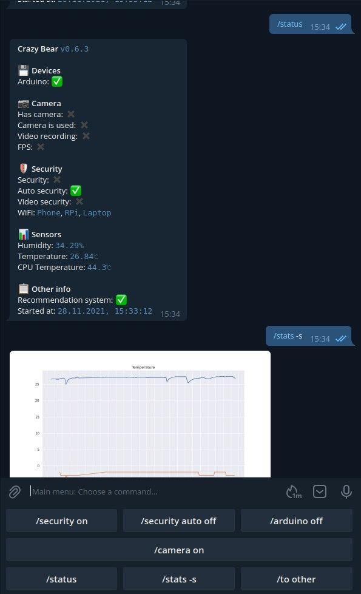

# CrazyBear — Home Automation in Telegram

> [!NOTE]  
> This project is not a general solution. This is just an implementation for specific purposes (my purposes 🙂).
> Some things were implemented quite simply so as not to complicate support.
> I hope the code will be helpful to you.

## Preview



## Components

1. **Raspberry Pi 4**
2. **Logitech C270 HD** (is connected via USB to the **Raspberry Pi**)
3. **CC2531** (is connected via USB to the **Raspberry Pi**)
4. And a lot of different smart devices connected via ZigBee.


## Setup

1. Install Docker and Docker Compose on the Raspberry Pi.
2. Create `config/prod.json` and `config/db.env` with your settings.
   See `project/config/variables.py` for required JSON keys, and adapt device names to your home.
3. Connect the Telegram webhook bridge and RabbitMQ service on the external `telehooks_mq` network.
   Configure any device integrations you use.
4. Build and start:

   ```bash
   docker compose -f docker-compose.prod.yml up -d --build
   ```

5. Set **ZigBee Dongle** (if you use **CC2531**)
    1. Connect **CC2531**
        1. Install **WiringPi**
            ```bash
            git clone https://github.com/WiringPi/WiringPi.git
            git checkout 5de0d8f5739ccc00ab761639a7e8d3d1696a480a
            cd WiringPi
            ./build
            ```
            (https://github.com/jmichault/flash_cc2531/issues/18)
        2. [https://kvvhost.ru/2019/05/29/zigbee2mqtt-cc2531-raspberry-pi/](https://kvvhost.ru/2019/05/29/zigbee2mqtt-cc2531-raspberry-pi/)
    2. Add devices.
